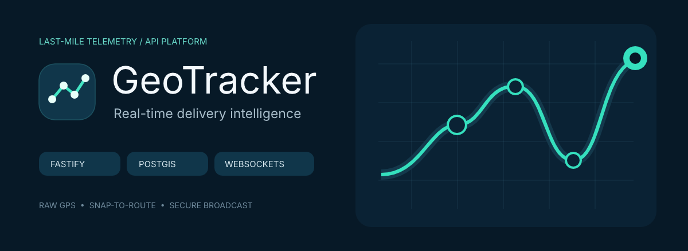

# GeoTracker API

<p align="center">
  
  <br><sub>Original artwork generated with VectorCraft · <a href="docs/public/geotracker-banner.svg">editable SVG source</a></sub>
</p>

> **PT-BR:** API de telemetria em tempo real para operações de entrega last-mile, com Fastify, TypeScript, PostgreSQL/PostGIS, JWT M2M e WebSockets.
>
> **EN-US:** Real-time telemetry API for last-mile delivery operations, built with Fastify, TypeScript, PostgreSQL/PostGIS, M2M JWT, and WebSockets.

> [!IMPORTANT]
> **Portfolio demonstration project / Projeto de demonstração de portfólio**
>
> This repository demonstrates high-performance API design, geospatial processing with PostGIS, auditability, and real-time delivery. It uses a generic last-mile logistics domain only and does not reproduce third-party intellectual property, public-transit flows, ticketing, passenger validation, or access-control concepts.
>
> Este repositório demonstra design de APIs de alta performance, processamento geoespacial com PostGIS, auditabilidade e tempo real. Ele usa exclusivamente um domínio genérico de logística last-mile e não replica propriedade intelectual de terceiros, fluxos de transporte público, bilhetagem, validação de passageiros ou controle de acesso.

## Architecture pitch / Pitch arquitetural

The API treats a GPS ping as an auditable fact first and an operational map point second. This distinction lets processing evolve without rewriting evidence received from a device.

A API trata um ping GPS primeiro como fato auditável e depois como ponto operacional de mapa. Essa distinção permite evoluir o processamento sem reescrever a evidência recebida de um dispositivo.

```text
Tracker JWT + POST /telemetry
          │
          ▼
raw_telemetry (append-only audit record)
          │
          ▼
PostGIS snap-to-route → processed_locations
          │                         │
          ▼                         ▼
201 Created             viewer JWT + vehicle-scoped WebSocket broadcast
```

### Data lifecycle / Ciclo de vida dos dados

1. **Ingest / Ingestão** — Fastify validates a tracker M2M JWT and the telemetry contract in [src/tracking/http/routes.ts](src/tracking/http/routes.ts).
2. **Audit / Auditoria** — the exact received latitude, longitude, accuracy, and capture time are written append-only to `raw_telemetry`; the database trigger rejects updates and deletes. See [002_tracking_schema.sql](src/db/migrations/002_tracking_schema.sql).
3. **Process / Processamento** — [postgres-telemetry-repository.ts](src/tracking/infrastructure/postgres-telemetry-repository.ts) selects the active route and uses `ST_ClosestPoint` plus geography `ST_Distance` to store the derived point and deviation in `processed_locations`.
4. **Deliver / Entrega** — after the transaction commits, [routes.ts](src/tracking/http/routes.ts) publishes only the processed event to the matching in-memory vehicle room managed by [vehicle-channel-manager.ts](src/realtime/vehicle-channel-manager.ts).

Read the [public architecture summary](docs/public/arquitetura.md) for the boundaries, data model, and operational decisions.

## Technical highlights / Destaques técnicos

- **Raw vs. processed data:** immutable `raw_telemetry` is separate from derived `processed_locations`, making audit and reprocessing first-class concerns.
- **Native PostGIS snap-to-route:** planned delivery paths are `LineString` geometries; GPS points are projected server-side with `ST_ClosestPoint` and measured in meters with `ST_Distance(...::geography)`.
- **Spatial performance foundation:** GiST indexes cover route paths and processed points. The documented query surface uses `ST_DWithin` for proximity and `ST_MakeLine` for historical traces when those read endpoints are introduced.
- **M2M security boundary:** JWTs carry `vehicle_id` and `viewer`/`tracker` roles. A tracker may ingest only for its vehicle; a viewer may subscribe only to that vehicle’s WebSocket room.
- **Real-time without raw-data leakage:** `tracking.position.updated` is emitted after persistence succeeds and contains only the processed coordinate.
- **Operational readiness:** structured logs avoid raw coordinates, `/metrics` exposes Prometheus-compatible runtime metrics, and Docker-based GitHub Actions runs migrations, typecheck, integration tests, and dependency audit.

## Run locally with Docker / Execute localmente com Docker

Docker Compose is the canonical environment. It pins Node 22, PostgreSQL/PostGIS, and the development workflow.

O Docker Compose é o ambiente canônico. Ele fixa Node 22, PostgreSQL/PostGIS e o fluxo de desenvolvimento.

```sh
cp .env.example .env
docker compose up --build --wait
docker compose exec api npm run migrate
docker compose exec api npm run test:integration
```

| Surface / Superfície | URL |
| --- | --- |
| Health check | [http://localhost:3000/health](http://localhost:3000/health) |
| Interactive Swagger UI / Swagger interativo | [http://localhost:3000/docs](http://localhost:3000/docs) |
| OpenAPI JSON | [http://localhost:3000/docs/json](http://localhost:3000/docs/json) |
| Prometheus metrics / Métricas Prometheus | [http://localhost:3000/metrics](http://localhost:3000/metrics) |

## Zero-setup realtime demo / Demo realtime sem setup manual

```sh
docker compose exec api npm run demo:realtime
```

The script creates a local demo route, mints development JWTs, opens an authenticated viewer WebSocket, ingests tracker telemetry, and prints the processed broadcast in the terminal.

O script cria uma rota local de demonstração, emite JWTs de desenvolvimento, abre um WebSocket autenticado como viewer, ingere telemetria como tracker e imprime o broadcast processado no terminal.

It is intentionally development-only and writes one append-only demo telemetry event per execution.

## API adoption / Adoção da API

Open [Swagger UI](http://localhost:3000/docs) to inspect and execute the documented contracts:

- `POST /development/tokens` — development-only M2M JWT generator for a vehicle and role.
- `POST /telemetry` — authenticated ingestion endpoint, including body validation and documented `201`, `400`, `401`, `403`, and `404` responses.

For a manual WebSocket test, use `Authorization: Bearer <VIEWER_TOKEN>` and connect to:

```text
ws://localhost:3000/ws/telemetry?vehicleId=<VEHICLE_ID>
```

## Validation and CI / Validação e CI

```sh
docker compose exec api npm run typecheck
docker compose exec api npm run test:integration
docker compose exec api npm audit --omit=dev --audit-level=high
```

The GitHub Actions workflow in [.github/workflows/ci.yml](.github/workflows/ci.yml) runs the same Docker-based verification on pushes and pull requests.

O workflow do GitHub Actions em [.github/workflows/ci.yml](.github/workflows/ci.yml) executa a mesma verificação baseada em Docker em pushes e pull requests.

## Scope and next production step / Escopo e próximo passo de produção

The channel manager is intentionally in-memory for a single API instance. Horizontal scaling requires a shared pub/sub layer such as Redis or NATS. OTLP trace export is intentionally pending a real collector endpoint.

O gerenciador de canais é intencionalmente em memória para uma única instância da API. Escalonamento horizontal exige uma camada compartilhada de pub/sub, como Redis ou NATS. A exportação de traces via OTLP aguarda intencionalmente um endpoint real de coletor.
